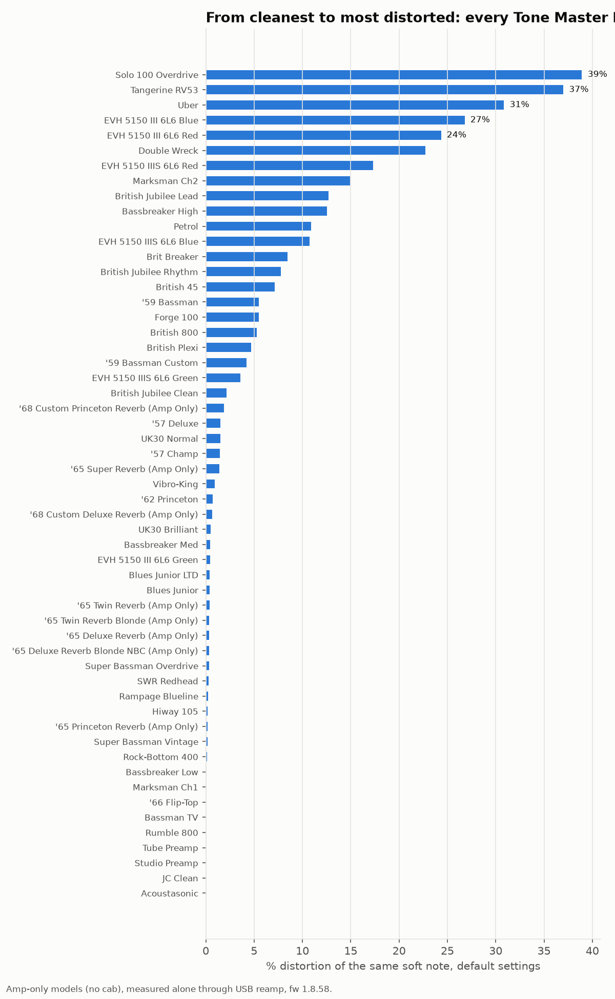
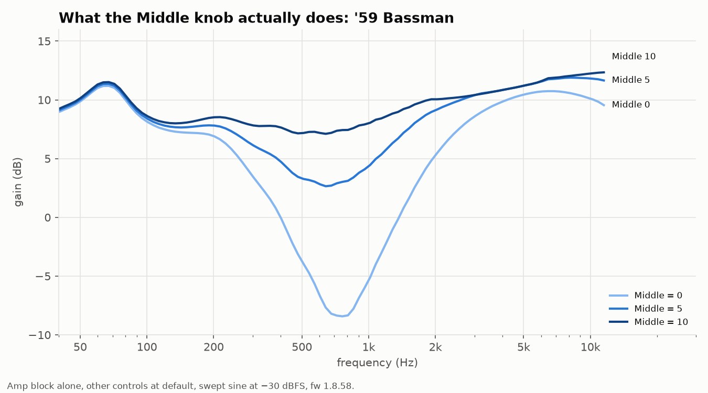
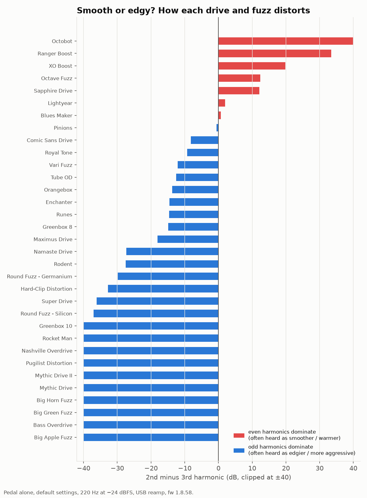
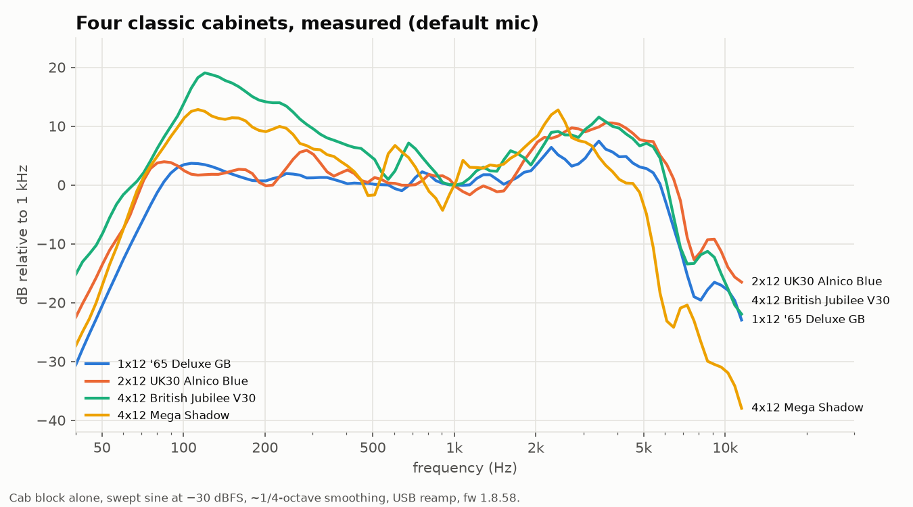

# Fender Tone Master Pro cheat sheet

**What's inside every factory preset, which amp to pick for which job, and what
the knobs really do**, based on measuring the unit itself.

I own a Tone Master Pro and kept wanting answers the manual doesn't give. So I
had a computer drive the unit over USB and measure it, one model at a time, at
firmware 1.8.58. This page is the useful part in plain language; the raw numbers
are at the bottom for anyone who wants them.

Not affiliated with or endorsed by Fender. No Fender files in this repo.

## 1. Factory presets: what's inside

- [**All 255 factory presets, block by block**](factory-presets.md): amp, cab and
  every pedal in signal order, and which blocks are on when the preset loads.
- [**Which presets use which amp or pedal**](presets-by-gear.md): like the sound
  of an amp? This lists every factory preset built on it.

The amps Fender used most in the factory presets: '65 Deluxe Reverb (29
presets), British Plexi (29), '65 Twin Reverb (27), British 800 (21) and
UK30 Brilliant (15).

## 2. Which amp for which job

Every amp, played the same way at its **default settings**. The gain or volume
knob moves any amp up or down this list, so read it as "where each amp starts".

| If you want… | Try |
|---|---|
| **Clean, even when you dig in** | JC Clean, Marksman Ch1, Bassbreaker Low, Studio Preamp, Tube Preamp, Acoustasonic, plus the bass amps ('66 Flip-Top, Bassman TV, Rock-Bottom 400, Rumble 800) |
| **Clean when you play soft, breaking up when you dig in** | most of the Fender family: '57 Champ, '57 Deluxe, '62 Princeton, '65 Princeton Reverb, '68 Custom Princeton Reverb, '65 Deluxe Reverb (and Blonde NBC), '68 Custom Deluxe Reverb, '65 Super Reverb, '65 Twin Reverb (and Blonde), '65 Twin Custom 15, Blues Junior (and LTD), Vibro-King; also UK30 Brilliant / Normal, British Jubilee Clean, Bassbreaker Med, EVH 5150 III 6L6 Green, Hiway 105, and the bass amps Rampage Blueline, SWR Redhead, Super Bassman Vintage / Overdrive |
| **Crunch** | British Plexi, British 800, British 45, Brit Breaker, British Jubilee Rhythm / Lead, '59 Bassman (and Custom), Bassbreaker High, Forge 100, Marksman Ch2, Petrol, EVH 5150 IIIS 6L6 Blue / Green |
| **High gain** | Solo 100 Overdrive, Tangerine RV53, Uber, Double Wreck, EVH 5150 III 6L6 Blue / Red, EVH 5150 IIIS 6L6 Red |

## 3. What the knobs actually do

Measured by turning one knob from 0 to 10 with everything else at default.
"Low end" ≈ 60–150 Hz, "warmth/body" ≈ 150–500 Hz, "mids/punch" ≈ 500 Hz–1.5 kHz,
"bite/presence" ≈ 1.5–5 kHz, "sparkle/fizz" ≈ 5–10 kHz.

**'59 Bassman**
- Vol Bright: starts to break up around 5
- Treble: mostly sparkle and bite (about +6 dB from 0 to 10)
- Bass: low end (+4 dB)
- **Middle: the big one** — about +13 dB of mids/punch from 0 to 10. Sound hollow or thin? Turn Middle up.
- Presence: a little more mids (+4 dB)

**'65 Deluxe Reverb**
- Volume: starts to break up only near 10
- Bass: low end (+13 dB) and body (+5 dB)
- Treble: bite (+14 dB) and sparkle (+11 dB). Small changes go a long way.

**'65 Twin Reverb**
- Volume: stays clean across its whole range when you play softly — the famous Twin headroom
- Bass: a lot of low end (+26 dB from 0 to 10). Go easy with it.
- Middle: mids/punch (+9 dB) and body (+6 dB)
- Treble: bite and sparkle (about +23 dB). Go easy with it too.

**British 800**
- Master: already breaking up at 0 (the preamp gain does the work)
- Bass: low end (+9 dB)
- Middle: mids/punch (+7 dB)
- Treble: sparkle (+15 dB) and bite (+10 dB)
- Presence: a little sparkle (+4 dB)

**EVH 5150 IIIS 6L6 Red**
- Gain: breaks up from about 2 upward
- Low: low end (+8 dB)
- Mid: mids/punch (+9 dB) and bite (+6 dB)
- High: sparkle (+11 dB) and bite (+9 dB)
- Presence: sparkle (+12 dB) and bite (+7 dB)

The Bassman Middle knob, for example, is a deep scoop around 600–700 Hz:

The same knob summary for 88 amps and pedals is in [knobs-tables.md](knobs-tables.md).

## 4. Drive pedals: smooth or edgy?

How a pedal distorts shapes its character. A common rule of thumb: pedals whose
distortion is dominated by **even** harmonics tend to sound smoother and warmer,
those dominated by **odd** harmonics edgier and more aggressive. It's a rule of
thumb, not a law, but it is a useful way to sort them:

| Character | Pedals |
|---|---|
| **Smoother / warmer** (even harmonics) | Blues Maker, Lightyear, Sapphire Drive, Ranger Boost, XO Boost, plus the octave effects (Octave Fuzz, Octobot) |
| **In between** | Greenbox 8, Tube OD, Royal Tone, Comic Sans Drive, Enchanter, Maximus Drive, Orangebox, Pinions, Runes, Vari Fuzz |
| **Edgier / more aggressive** (odd harmonics) | the Big Muff family (Big Apple, Big Green, Big Horn), Round Fuzz (Silicon, Germanium), Greenbox 10, Mythic Drive I / II, Nashville Overdrive, Namaste Drive, Hard-Clip Distortion, Pugilist Distortion, Rocket Man, Rodent, Super Drive, Bass Overdrive |

## 5. For the nerds: method and raw data

- **Unit**: Tone Master Pro, firmware 1.8.58, controlled from a computer over USB.
- **Signal path**: USB re-amping into the chain, result recorded from the main
  USB outputs. With an empty chain the path measures −6.02 dB flat (100 Hz–10 kHz,
  −40 to −6 dBFS), exactly the preset level of 0.5 used throughout, so every
  curve is the block itself.
- **Isolation**: each model alone in a series chain, everything else empty,
  default parameters as the unit sets them when the block is inserted.
- **Tone curves**: exponential sine sweep 20 Hz–20 kHz at −30 dBFS, 1/12-octave.
- **Distortion**: 220 Hz sine at −60…−6 dBFS. "Soft" in this page = −36 dBFS,
  "dig in" = −12 dBFS (digital levels, not a calibrated guitar level).
- **Knobs**: gain-type control at 0 / 2.5 / 5 / 7.5 / 10, tone controls at
  0 / 5 / 10, one at a time.

**Limits.** Default settings only (plus the knob sweeps). A single test tone is a
simplification of a real chord. On high-gain amps the tone controls interact with
the distortion, so the knob numbers are less exact there (the Plexi is left out of
the knob section for that reason). Delays, reverbs, modulation and pitch are not
measured yet. Measurements describe the models; they don't replace playing them.

**Files**: [atlas-tables.md](atlas-tables.md) (numbers for all 247 measured
models), [knobs-tables.md](knobs-tables.md), [models.md](models.md) (all 352
blocks with their controls), [data/](data/) (raw JSON), and a cabinet comparison:

## Feedback

What should be measured next? Something look wrong? Open an issue.

## License

Data, charts and text: [CC BY 4.0](https://creativecommons.org/licenses/by/4.0/).
Fender and Tone Master are trademarks of Fender Musical Instruments Corporation;
other product names belong to their owners. Model names are shown as the unit
displays them.
