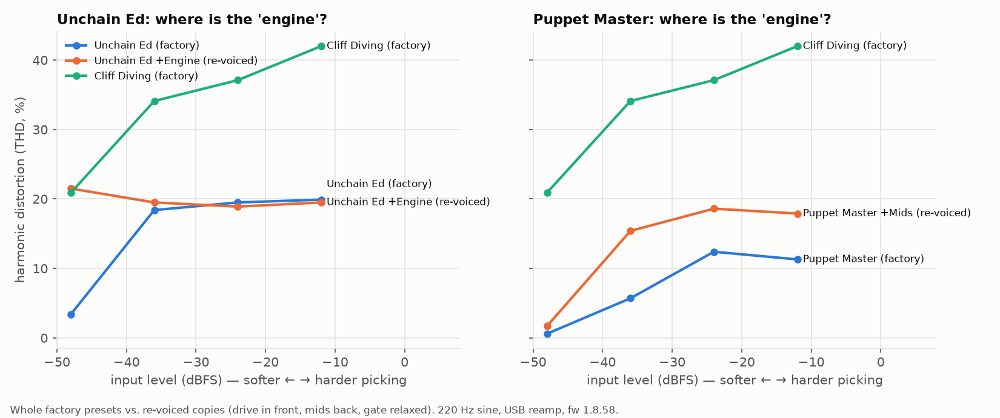

# Every model in the Fender Tone Master Pro, measured

I own a Fender Tone Master Pro and wanted to know what its models actually *do*,
not what the marketing says. So I set up a computer to drive the unit
automatically: build a chain with one block, play test signals into it over USB,
record what comes back, then move on to the next block. Overnight that gave
measurements of **247 models**, knob sweeps for **88 of them**, and the full
chain of every one of the **255 factory presets**.

Everything here is my own measurement or my own write-up. There are no Fender
files, firmware or IRs in this repo. Not affiliated with or endorsed by Fender.

**What's here**

| | |
|---|---|
| [`factory-presets.md`](factory-presets.md) | The signal chain of all 255 factory presets (firmware 1.8.58), block by block. I searched for this list and never found it. |
| [`models.md`](models.md) | All 352 blocks you can pick on the unit, by category, with their controls. |
| [`atlas-tables.md`](atlas-tables.md) | Per-model numbers: how early it breaks up, how much it distorts, even vs. odd harmonics, tone curve. |
| [`knobs-tables.md`](knobs-tables.md) | What each knob does: where in the spectrum it acts and by how much. |
| [`data/`](data/) | Raw measurements as JSON (frequency response on a 1/12-octave grid, level sweeps, knob sweeps). |

## Why does one preset feel like it has an "engine"?

This started with a question: the factory presets *Unchain Ed* and *Puppet
Master* felt flat to me for hard rock, while *Cliff Diving* felt alive.

The measurements suggest why. *Cliff Diving* is already saturated when you pick
softly: 21 % harmonic distortion at the quietest input, where Unchain Ed shows 3 % and Puppet Master under 1 %.
Its chain is a Tube Driver pushing a cranked Plexi, with a mid boost after it.
*Puppet Master* has a noise gate that shuts quiet notes off completely (−48 dBFS
in → −58 dBFS out) and scooped mids. Re-voicing them (drive pedal on in front,
mids back, gate relaxed) moves both curves toward *Cliff Diving*. Whether that
is the "engine" is for ears to decide, but now there is something to point at.

## How hard does each amp break up?

Same quiet note, default settings, amp block only (no cab). From the Soldano-,
Orange- and Bogner-inspired models at the top down to the clean Fenders and
preamps at the bottom.

## Even or odd: the harmonic fingerprint of every drive

This one is a sanity check that the method works: the Big Muff-style fuzzes come
out with almost no 2nd harmonic (symmetric clipping), and the octave fuzzes are
dominated by even harmonics, exactly what a rectifier circuit produces. The
models behave like the circuits they are based on.

## What a knob actually does

The '59 Bassman's Middle control: the classic Fender tone-stack scoop around
600–700 Hz, about 15 dB deeper at 0 than at 10, where only a slight dip remains.
[`knobs-tables.md`](knobs-tables.md) has the same summary for every knob on 88
models.

## Cabinets

Four classic cabs with their default mic. Note how much earlier the closed-back
4x12 rolls off above 4 kHz.

## Method

- **Unit**: Tone Master Pro, firmware 1.8.58, controlled from a computer over USB.
- **Signal path**: USB re-amping into the guitar input of the chain, result
  recorded from the main USB outputs. With an empty chain the path measures
  −6.02 dB flat (100 Hz–10 kHz, −40 to −6 dBFS), exactly the preset level of
  0.5 used throughout. So every curve here is the block itself.
- **Isolation**: each model alone in a series chain, every other path empty,
  default parameters as the unit sets them when the block is inserted.
- **Frequency response**: exponential sine sweep 20 Hz–20 kHz at −30 dBFS,
  linear part of the impulse response, 1/12-octave bands, relative to the
  empty chain.
- **Level response**: 220 Hz sine at −60, −48, −36, −30, −24, −18, −12, −6 dBFS;
  output level, THD (harmonics 2–8), harmonics 2–6 relative to the fundamental.
- **Knob sweeps**: the gain-type control at 0 / 2.5 / 5 / 7.5 / 10 and each tone
  control at 0 / 5 / 10, one at a time, everything else at default.

**Limits.** Default settings only (plus the knob sweeps). Input levels are
digital (dBFS), not a calibrated guitar level. THD from a single sine is a
simplification of how distortion feels under a real chord. Delays, reverbs,
modulation and pitch blocks are not measured yet (they need time-domain tests).
Measurements describe the models; they don't replace playing them.

## Feedback

What should be measured next? Open an issue. Corrections welcome.

## License

Data and text: [CC BY 4.0](https://creativecommons.org/licenses/by/4.0/).
Fender and Tone Master are trademarks of Fender Musical Instruments Corporation;
other product names belong to their owners. Model names are shown as the unit
displays them.
